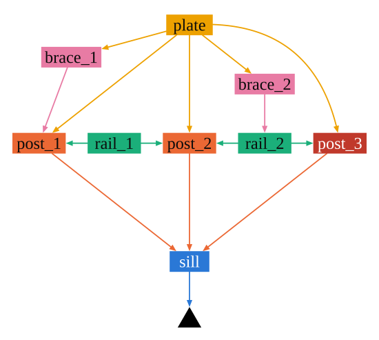
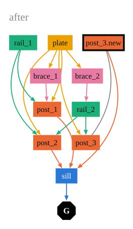

# Intervention Grammar

<p class="lead">
A grammar of interventions in existing structures.
</p>

A structure is a set of members and their connections. Operators change it:
they cut, split, join, remove and add members, change the shape of a joint,
release and secure connections, lift and prop, and record what is found.
Approaches compose operators into interventions: repairs, reinforcements,
additions and alterations. A program of operations runs on a model step by
step, and its inverse undoes it.

<div class="figures" markdown>
<figure markdown>
  
  <figcaption>A timber demo wall with a damaged member. The foot of post_3 is damaged (marked red).</figcaption>
</figure>
<figure markdown>
  
  <figcaption>After a prosthesis. The foot of post_3 is cut off, and post_3 rests on a new piece (black ring) that stands on the sill.</figcaption>
</figure>
</div>

Each box is a member, placed where it is in the wall and coloured by its role.
An arrow points from a member to the member it rests on, down to the ground
(black triangle).

The operators describe what is done to a structure, whoever carries it out
and whatever the material. Operators that work along a member (Split, Trim,
Extend, Turn, Machine) measure positions in stations along its axis, so the
grammar is made for frames and trusses of linear members.

The structure is a [compas_model](https://github.com/blockresearchgroup/compas_model)
`Model`, and the state of the intervention lives on its graph. The same
operations therefore run on any compas_model element, for example the beams
of a [compas_timber](https://gramaziokohler.github.io/compas_timber/) model.
Every operation is a COMPAS `Data` class and saves and loads as JSON.

```python
from intervention_grammar import demo, run, inverse
from intervention_grammar import Probe, Prosthesis

wall = demo.wall()
program = [
    Probe("post_3", at=0.1, finding="damaged"),
    Prosthesis("post_3", length=0.4, joint={"family": "lap", "length": 0.3}),
]
states = run(wall, program)    # every state, step by step
undo = inverse(wall, program)  # the program that undoes it
```

Start with the [concepts](concepts.md), look up the [operators](operators.md)
and [approaches](approaches.md), or follow the [examples](examples.md).
The drawings on this page are made with
[graph_drawing](https://augmentedfabricationlab.github.io/graph_drawing/).

Intervention Grammar is developed by Tizian Rein at the
[Professorship of Digital Fabrication](https://www.arc.ed.tum.de/df),
Technical University of Munich.
